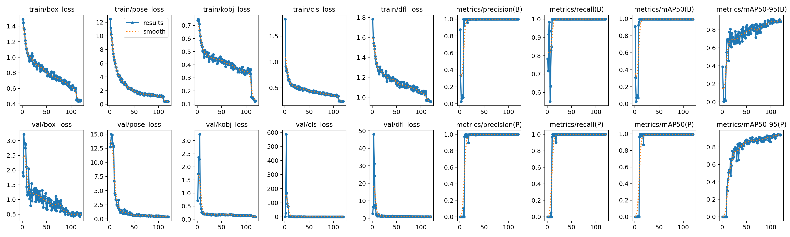
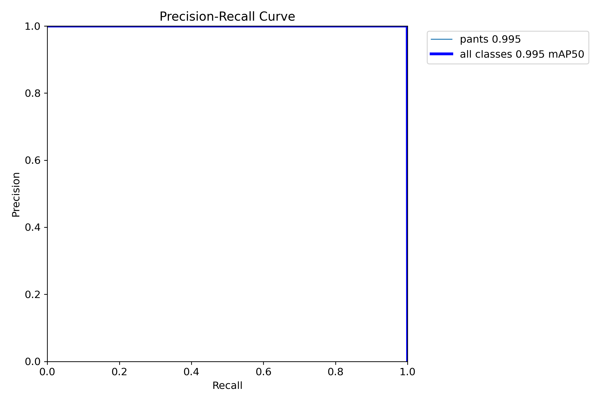
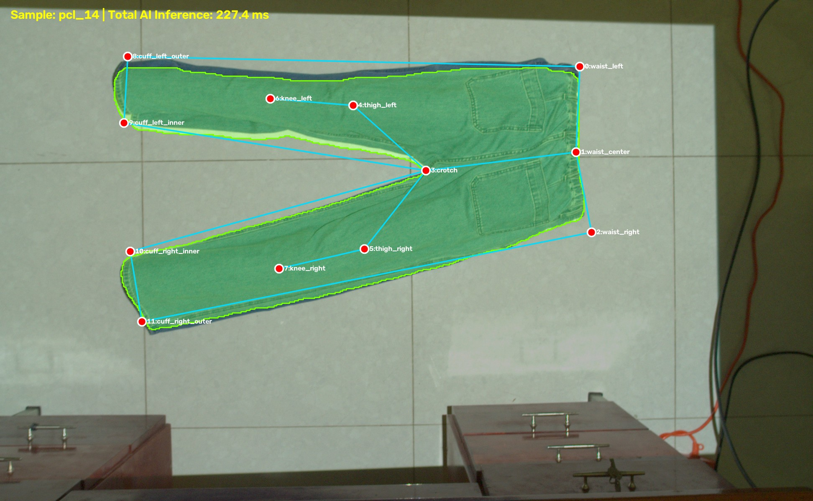
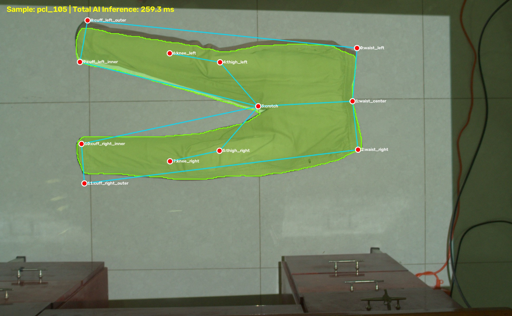
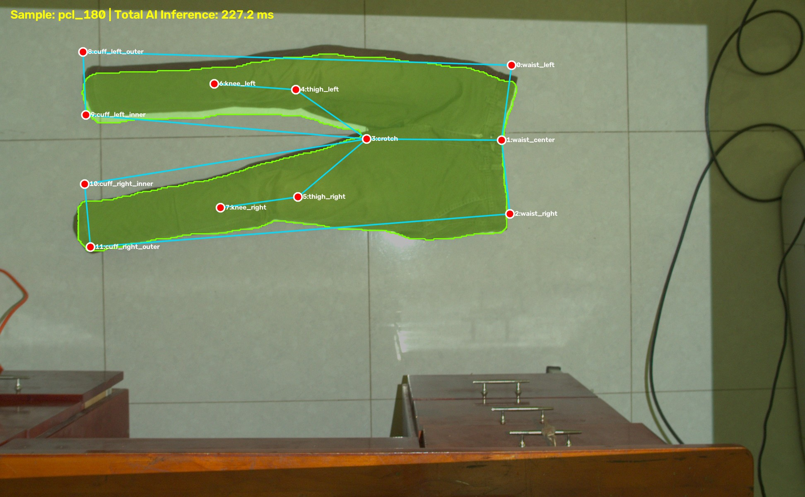
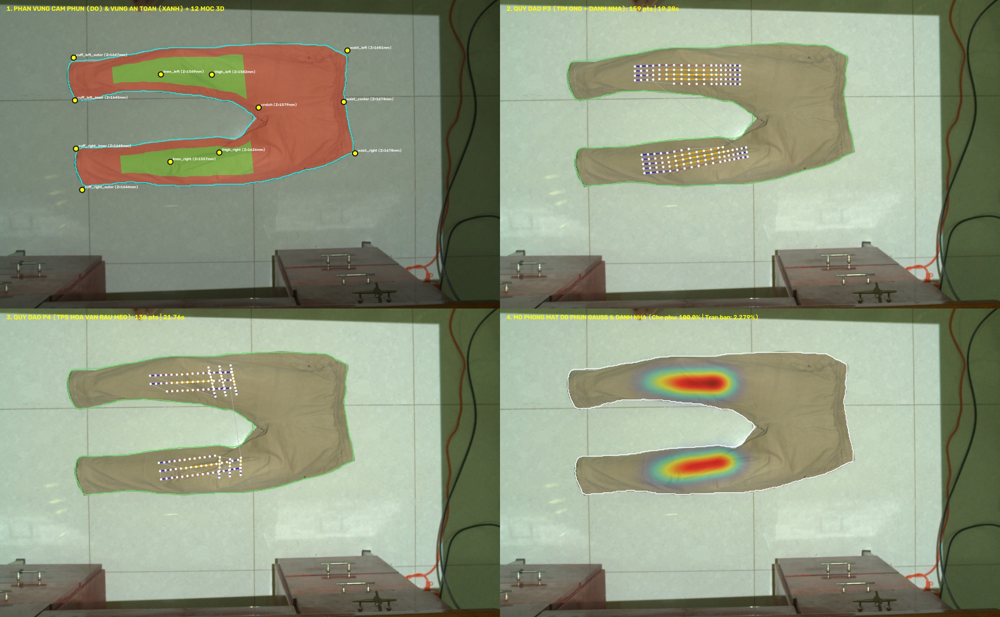
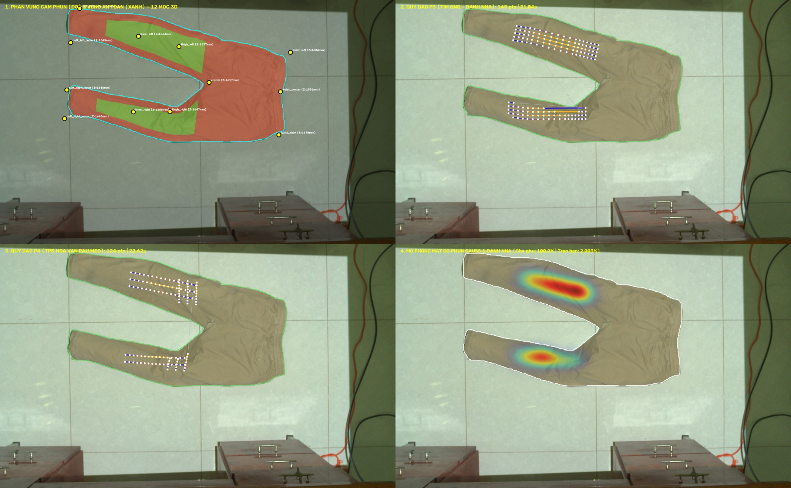
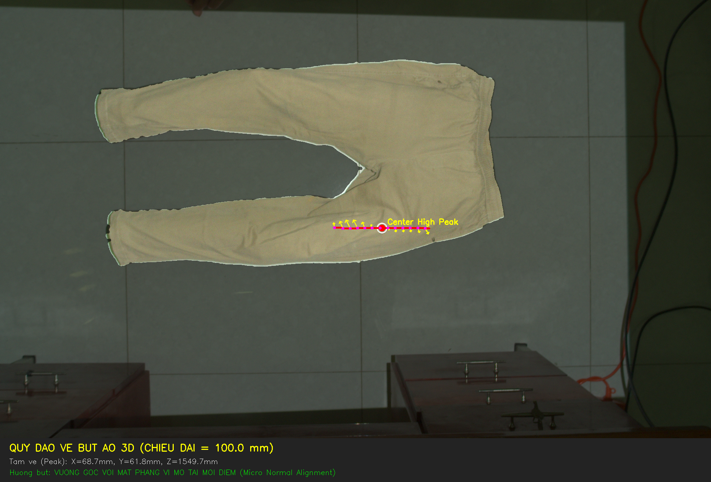
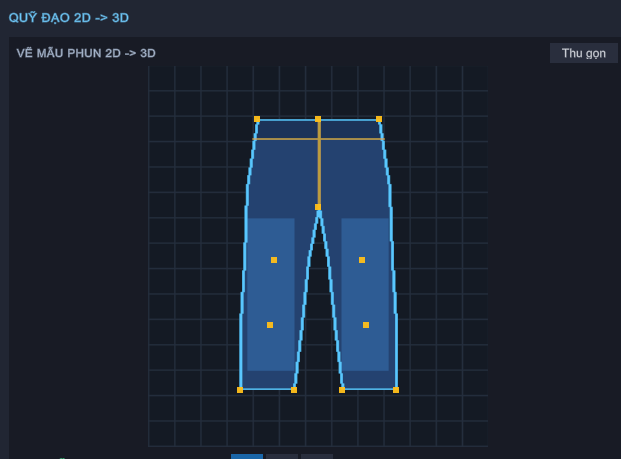

# 🤖 Hệ Thống Tự Động Hóa Nhận Diện 3D & Sinh Quỹ Đạo Phun Sơn cho Robot Dobot CR10A (6-DOF)

> **Dự án R&D**: Tự động hóa quy trình nhận diện phôi may mặc 3D (quần jean/kaki), phân loại kích thước (Size S/M/L), bù đắp chỗ khuất bề mặt vải, ánh xạ mẫu phun phi tuyến (TPS RBF), đánh giá chất lượng phun theo mô hình Gauss 3D và mô phỏng/xuất lệnh điều khiển 6-DOF cho cánh tay robot **Dobot CR10A**.

---

## 📑 Mục Lục

1. [Tổng Quan & Bài Toán](#-1-tổng-quan--bài-toán)
2. [Kiến Trúc Hệ Thống](#-2-kiến-trúc-hệ-thống)
3. [Cấu Trúc Thư Mục Dự Án](#-3-cấu-trúc-thư-mục-dự-án)
4. [Mô Hình AI & Kết Quả Huấn Luyện (YOLO11s-Pose & YOLO11s-Seg)](#-4-mô-hình-ai--kết-quả-huấn-luyện)
5. [Kết Quả Kiểm Thử Thực Tế & Sinh Quỹ Đạo 3D](#-5-kết-quả-kiểm-thử-thực-tế--sinh-quỹ-đạo-3d)
6. [Giao Diện & Tính Năng Unity 3D Workbench](#-6-giao-diện--tính-năng-unity-3d-workbench)
7. [Hướng Dẫn Cài Đặt & Vận Hành](#-7-hướng-dẫn-cài-đặt--vận-hành)
8. [Giao Thức Truyền Thông & Xuất Lệnh Robot Thật](#-8-giao-thức-truyền-thông--xuất-lệnh-robot-thật)

---

## 🌟 1. Tổng Quan & Bài Toán

Trong bài toán phun sơn / cào sờn hoa văn lên phôi quần đặt trên bàn thao tác, hệ thống giải quyết 4 thách thức thực tế:

- **Biến dạng & nếp gấp vải 3D**: Quần có nếp nhăn và góc khuất (self-occlusion) khiến camera 3D Zivid mất dữ liệu cục bộ.
- **Thay đổi kích thước phôi**: Mỗi chiếc quần có kích thước khác nhau (Size S/M/L) khiến quỹ đạo cố định dễ lệch vị trí hoặc phun tràn biên vải.
- **Độ lớn đám mây điểm 3D**: Mỗi frame Zivid có tới `1200 × 1944` (~2.33 triệu điểm, ~1.7 triệu điểm hợp lệ), nặng khi hiển thị và raycast thời gian thực.
- **Đảm bảo động học & an toàn robot**: Quỹ đạo 3D cần đồng nhất tốc độ TCP (`MovL`), nghiêng đầu phun thích nghi theo pháp tuyến bề mặt vải, không chạm bàn và giải được đầy đủ 6 góc khớp cho **Dobot CR10A**.

**Các khối chức năng cốt lõi đã triển khai:**

1. **AI Vision (YOLO11s-Pose & YOLO11s-Seg)**: Phân đoạn biên thân quần và định vị 12 điểm mốc giải phẫu cốt lõi (`waist`, `crotch`, `thigh`, `knee`, `cuff`).
2. **Chiếu 3D & Sinh Quỹ Đạo (P1 / P3 / P4 + TPS RBF)**: Chiếu 2D → 3D theo đám mây điểm Zivid, tính pháp tuyến vi mô bề mặt vải, tự co giãn mẫu phun theo Size S/M/L.
3. **Bù Đắp Chỗ Khuất & 3D Surface Mesh**: Chuyển Point Cloud thành lưới bề mặt 3D nhẹ (1 Draw Call) kèm 5 phương pháp vá vùng khuất (K-NN MLS/PCA, TPS RBF, Poisson/Laplacian PDE, Adaptive Gun Tilt, đối xứng 2 ống).
4. **Hiệu Chuẩn Camera – Robot (Eye-to-Hand 4×4)**: Tinh chỉnh trực tiếp tọa độ/góc camera (`Tx, Ty, Tz, Roll, Pitch, Yaw`), giải ma trận cứng 4×4 bằng **Kabsch / Horn Quaternion SVD** từ ≥ 3 cặp điểm chạm mốc, kiểm chứng ngân sách sai số RSS ≤ 5 mm.
5. **Đánh Giá Phun Gauss 3D & Xuất Lệnh**: So sánh P1/P3/P4 theo bộ chỉ tiêu hình học, độ phủ, tỷ lệ tràn biên, độ đều tốc độ TCP (`CV%`), xuất chương trình **Dobot Python**, **CSV 6-DOF** và **ROS 2**.

---

## 🔬 2. Kiến Trúc Hệ Thống

```text
+----------------------------------------------------------------------+
|                CAMERA 3D ZIVID (FIXED L-BRACKET RIG)                 |
|     Ảnh RGB 2D (1944x1200) + Đám mây điểm 3D có tổ chức (.ply/.zdf)  |
+----------------------------------+-----------------------------------+
                                   |
          +------------------------+------------------------+
          v                                                 v
+------------------------------------+    +----------------------------------------+
|       AI BACKEND SERVER (PYTHON)   |    |        UNITY 3D WORKBENCH (C# / URP)   |
|  ai_src/step3_3d_trajectory/       |    |        dobot_cr10a/Assets/src/         |
+------------------------------------+    +----------------------------------------+
| - YOLO11s-Seg  (best_yolo11_seg)   |    | - PLYDirectLoader (3D Mesh / Cloud)    |
| - YOLO11s-Pose (best_yolo11_pose)  |    | - CalibrationManager (Eye-to-Hand 4x4) |
| - Step3TrajectoryPipeline3D (TPS)  |    | - FixedRigCamera (POV / PiP / FOV)     |
| - ZividCapture (chụp camera thật)  |    | - DobotCR10AIKController (8-Tab UI)    |
| - run_server.py (Windows v3.0)     |    | - DobotCR10AKinematics (8-branch IK)   |
|   UDP :5005 | HTTP :5000           |<-->| - TrajectoryEvaluationEngine (Gauss)   |
+------------------------------------+    +-------------------+--------------------+
                                                              |
                                                              v
                                          +----------------------------------------+
                                          |       ĐẦU RA CHO ROBOT DOBOT CR10A     |
                                          | - Script Dobot Python SDK (.py)        |
                                          | - Quỹ đạo 6-DOF & TCP (.csv / .json)   |
                                          | - So sánh P1/P3/P4 & Mesh đã vá (.obj) |
                                          +----------------------------------------+
```

---

## 📂 3. Cấu Trúc Thư Mục Dự Án

```text
Dobot-CR10A/
├── ai_src/
│   ├── step1_auto_label/
│   │   ├── step1_auto_labeling_3d.py          # Tự động gán nhãn 12 mốc 3D từ RGB + Depth
│   │   ├── landmark_editor_app.py             # Tool Desktop kéo thả chỉnh sửa 12 mốc thủ công
│   │   └── LANDMARK_EDITOR_GUIDE.md
│   ├── step2_train_yolo/
│   │   ├── weights/
│   │   │   ├── best_yolo11_pose.pt            # Trọng số YOLO11s-Pose (12 mốc giải phẫu)
│   │   │   └── best_yolo11_seg.pt             # Trọng số YOLO11s-Seg (phân đoạn thân quần)
│   │   ├── reports/
│   │   │   ├── yolo11s_pose_jeans/            # Biểu đồ train/val, PR/F1 curve, results.csv
│   │   │   └── yolo11s_seg_jeans/             # Biểu đồ train/val, PR/F1 curve, results.csv
│   │   ├── inference_results/                 # 20 ảnh kiểm thử thực tế (Seg + 12 Keypoints)
│   │   ├── dobot_cr10a_yolo11_kaggle_notebook.ipynb
│   │   ├── prepare_kaggle_dataset.py
│   │   └── test_inference_step2.py
│   ├── step3_3d_trajectory/
│   │   ├── run_server.py                      # AI Server Windows v3.0 (UDP 5005 & HTTP 5000)
│   │   ├── unity_ai_server.py                 # Lõi xử lý AI + cầu nối động học Unity/Dobot
│   │   ├── step3_3d_trajectory_generator.py   # Sinh quỹ đạo 3D P3/P4 (TPS RBF + pháp tuyến)
│   │   ├── zivid_capture.py                   # Adapter chụp trực tiếp từ camera Zivid SDK
│   │   ├── calibration.py                     # Nạp & áp dụng ma trận hiệu chuẩn 4x4
│   │   ├── frame_io.py                        # Đọc/ghi frame RGB + XYZ (.ply/.npz)
│   │   ├── run_ai_server.sh                   # Script khởi động nhanh trên Linux
│   │   └── outputs/                           # Dashboard 4 khung, 3D rendered view, CSV/JSON
│   ├── HUONG_DAN_AI_PIPELINE.md
│   └── HUONG_DAN_AI_PIPELINE.pdf
├── dobot_cr10a/                               # Unity Project (Unity 6 / URP)
│   ├── Assets/
│   │   ├── Scenes/SampleScene.unity           # Scene chính mô phỏng Dobot CR10A + Zivid Rig
│   │   ├── PointCloud/                        # Shader & đám mây điểm mẫu
│   │   └── src/
│   │       ├── DobotCR10AIKController.cs      # Điều khiển trung tâm, giao diện 8 Tab, auto-save
│   │       ├── DobotCR10AKinematics.cs        # Động học thuận/nghịch giải tích 6-DOF (8 nhánh)
│   │       ├── CalibrationManager.cs          # Hiệu chuẩn Eye-to-Hand 4x4 & Kabsch/Horn SVD
│   │       ├── TrajectoryEvaluationEngine.cs  # Đánh giá P1/P3/P4, Heatmap Gauss 3D, khuôn đứng
│   │       ├── PLYDirectLoader.cs             # Nạp PLY Zivid, chuyển 3D Mesh, vá lỗ hình thái
│   │       ├── FixedRigCamera.cs              # Mô phỏng giá treo chữ L Zivid & vùng nhìn FOV
│   │       ├── RobotCameraController.cs       # Orbit/Pan/Zoom, góc nhìn Zivid POV & PiP
│   │       ├── AiServerClient.cs              # Client UDP 5005 / HTTP 5000 / Auto-Push 5006
│   │       ├── DraggableUIPanel.cs            # Khung bảng điều khiển gắn phải có thể kéo giãn
│   │       ├── AntigravityUITheme.cs          # Theme Obsidian Dark cho Unity IMGUI
│   │       └── manual.cs                      # Điều khiển thủ công FK/IK từng khớp q1–q6
│   └── output_drawing/                        # Quỹ đạo xuất (.csv, .py, mẫu phun JSON)
├── docs/images/                               # Ảnh chụp giao diện Unity phục vụ tài liệu
├── HUONG_DAN_CAMERA.md                        # Hướng dẫn chụp trực tiếp từ camera Zivid thật
└── README.md
```

---

## 🧠 4. Mô Hình AI & Kết Quả Huấn Luyện

Hệ thống sử dụng 2 mô hình **Ultralytics YOLO11s** huấn luyện trên GPU Kaggle (`imgsz=640`, `batch=16`, AMP bật, augmentation xoay `±15°`, scale `0.25`, lật ngang `0.5`, mosaic `0.5`, tắt mosaic 10 epoch cuối).

### Bảng tổng hợp kết quả huấn luyện (từ `results.csv`)

| Mô hình | Trọng số | Epochs | Thời gian train | Box mAP@50 | Box mAP@50-95 (Max) | Task mAP@50 | Task mAP@50-95 (Max) | Đỉnh F1-Conf |
| :--- | :--- | :---: | :---: | :---: | :---: | :---: | :---: | :---: |
| **YOLO11s-Pose** (12 mốc giải phẫu) | `best_yolo11_pose.pt` (19.8 MB) | 120 | ~16.2 phút | **99.50%** | **91.81%** | **99.50%** *(Pose)* | **94.56%** *(Pose, ep 114)* | **1.00** @ `0.825` |
| **YOLO11s-Seg** (biên thân quần) | `best_yolo11_seg.pt` (20.5 MB) | 100 | ~15.7 phút | **99.50%** | **99.05%** | **99.50%** *(Mask)* | **98.78%** *(Mask, ep 80)* | **1.00** @ `0.910` |

---

### 4.1. Mô hình YOLO11s-Pose (Định vị 12 điểm mốc giải phẫu)

12 điểm mốc được dự đoán gồm: `0: waist_left`, `1: waist_center`, `2: waist_right`, `3: crotch`, `4: thigh_left`, `5: thigh_right`, `6: knee_left`, `7: knee_right`, `8: cuff_left_outer`, `9: cuff_left_inner`, `10: cuff_right_inner`, `11: cuff_right_outer`.


*Biểu đồ hàm mất mát (Train/Val Box, Pose, Keypoint Objectness) và độ chính xác mAP qua 120 epochs của YOLO11s-Pose (`val/pose_loss` giảm từ 12.75 xuống 0.38).*

| Đường cong Pose F1-Confidence | Đường cong Pose Precision-Recall |
| :---: | :---: |
|  |  |


*Kết quả dự đoán khung bao và 12 mốc giải phẫu trên batch kiểm định (Validation) với nhiều màu vải và góc đặt quần khác nhau.*

---

### 4.2. Mô hình YOLO11s-Seg (Phân đoạn biên thân quần & tách nền)


*Biểu đồ hàm mất mát và độ chính xác phân đoạn qua 100 epochs của YOLO11s-Seg (`val/seg_loss` giảm từ 3.19 xuống 0.30, Mask mAP@50-95 đạt 98.78%).*

| Đường cong Mask F1-Confidence | Đường cong Mask Precision-Recall |
| :---: | :---: |
|  |  |


*Kết quả phân đoạn mặt nạ thân quần (confidence 1.0) trên batch Validation của YOLO11s-Seg.*

---

## 🧪 5. Kết Quả Kiểm Thử Thực Tế & Sinh Quỹ Đạo 3D

### 5.1. Một số ảnh test kết hợp YOLO11s-Seg + YOLO11s-Pose

Các ảnh dưới đây được chạy từ script `ai_src/step2_train_yolo/test_inference_step2.py` trên dữ liệu chụp thật từ camera Zivid (hiển thị đồng thời đường biên segmentation màu xanh lá, khung xương nối 12 mốc giải phẫu và thời gian suy luận trên CPU):

| Mẫu `pcl_14` (Quần jean xanh) | Mẫu `pcl_105` (Quần kaki sáng) |
| :---: | :---: |
|  |  |
| **Mẫu `pcl_120` (Quần đặt nghiêng)** | **Mẫu `pcl_180` (Quần màu tối)** |
|  |  |

---

### 5.2. Dashboard tổng hợp Bước 3: Phân vùng phun, Quỹ đạo P3/P4 & Bản đồ mật độ Gauss

Mỗi dashboard gồm 4 khung đánh giá trực quan: **(1)** Phân vùng cấm phun (đỏ) & vùng an toàn (xanh) kèm cao độ `Z` của 12 mốc 3D, **(2)** Quỹ đạo P3 theo tim ống & đánh nhả, **(3)** Quỹ đạo P4 ánh xạ hoa văn râu mèo bằng TPS RBF, **(4)** Mô phỏng mật độ phun Gauss (độ phủ đạt **100.0%**, tràn biên chỉ **2.00% – 2.28%**):


*Dashboard Bước 3 trên mẫu `pcl_101`: P3 (159 điểm, 19.28s), P4 TPS râu mèo (138 điểm, 21.76s), độ phủ Gauss 100.0%, tràn bàn 2.279%.*


*Dashboard Bước 3 trên mẫu `pcl_120`: P3 (149 điểm, 21.04s), P4 TPS râu mèo (124 điểm, 22.62s), độ phủ Gauss 100.0%, tràn bàn 2.003%.*

---

### 5.3. Bám bề mặt cong 3D & hướng súng vuông góc pháp tuyến vi mô

| Góc nhìn 3D Isometric (Point Cloud + vector bút/súng vuông góc) | Hình chiếu 2D đỉnh nếp gấp & vector pháp tuyến |
| :---: | :---: |
|  |  |

---

## 🖥️ 6. Giao Diện & Tính Năng Unity 3D Workbench

Phần mềm mô phỏng và vận hành trong Unity (`dobot_cr10a`) sử dụng giao diện **Obsidian Dark** với thanh điều hướng trên cùng (gồm các nút chạy nhanh `Chạy / Tạm dừng`, `Home`, `Quỹ đạo: Bật/Tắt`, `Lưu setup`, `Cỡ mặc định`, `Ẩn/Mở bảng`) và **bảng chi tiết gắn cố định bên phải** có thể kéo giãn chiều rộng mà không che khuất khung nhìn 3D.

### Hệ thống 8 Tab chức năng

| Tab | Chức năng chính |
| :--- | :--- |
| **1. Phôi** | Chụp trực tiếp từ camera Zivid (`Chụp Zivid`, `Chụp + AI`), duyệt/nạp file `.ply`, chuyển đổi `3D Mesh` / `Point Cloud`, nhận diện Size S/M/L, bật/tắt 12 mốc AI & vùng phun. |
| **2. Views** | Góc nhìn nhanh (`3/4`, `Trên`, `Trước`, `Ngang`, `Focus Phôi`, `Focus Robot`), xem trực tiếp từ ống kính **Camera Zivid (POV)** hoặc khung hình nhỏ **PiP Cam**. |
| **3. Vá lỗ** | Quét & khoanh đỏ vùng bị khuất trên phôi 3D, chạy 5 phương pháp vá (K-NN MLS/PCA, TPS RBF, Poisson/Laplacian PDE, Adaptive Gun Tilt, đối xứng 2 ống), dựng 3D Mesh hoàn chỉnh & xuất `.OBJ`. |
| **4. Quỹ đạo & MP** | Gồm 2 tab con: **Mô phỏng** (giữ tốc độ TCP đều `MovL`, đo `v`, `CV%`, `t_cycle`, thanh kéo từng waypoint) và **Quỹ đạo 2D → 3D** (bảng vẽ 2D trực tiếp, lưu/nạp mẫu JSON, độ cao Z, sinh P1/P3/P4, cấu hình IP/Port AI Server). |
| **5. Đánh giá** | Chỉnh tham số súng phun (`d`, `w`, chồng lấn `r`, `σ`, góc nghiêng tối đa, biên `e`), chạy so sánh **P1 / P3 / P4**, hiển thị **Heatmap phun Gauss 3D**, bật bàn thao tác (Collider) & bài kiểm chứng **khuôn đứng 3D**. |
| **6. Xuất** | Xuất chương trình chạy robot thật **Dobot CR10A Python (.py)**, **CSV 6-DOF** và **ROS 2**, nạp lại file CSV bất kỳ để kiểm tra. |
| **7. Cấu hình** | Gồm 2 tab con: **Robot & Đầu phun** (gia tốc, tốc độ từng khớp J1–J6, chỉnh khớp thủ công q1–q6, offset bích → TCP `X/Y/Z`, vệt phun mô phỏng) và **Hiệu chuẩn Camera** (vị trí/góc camera `Tx/Ty/Tz/Roll/Pitch/Yaw`, FOV & mô hình giá treo 3D, ma trận 4×4 JSON, bù lệch 1 điểm, giải SVD đa điểm ≥ 3 cặp, ngân sách sai số RSS). |
| **8. An toàn** | Chẩn đoán tự động toàn bộ quỹ đạo: giới hạn góc khớp, lỗi giải IK, chạm bàn (`Z` thấp), vượt góc nghiêng súng và khóa an toàn trước khi mô phỏng/xuất lệnh. |

> **Tự động lưu cấu hình**: Mọi thiết lập trong Unity tự động lưu vào `dobot_cr10a/UserSettings/CR10A_WorkbenchSetup.json`, `CR10A_CalibrationSetup.json` và `PlayerPrefs` (hoặc bấm nút **`Lưu setup`** trên thanh tiêu đề) để giữ nguyên trạng thái qua các lần Stop/Play hoặc mở lại Unity.

### Ảnh giao diện Unity


*Bảng vẽ mẫu phun 2D → 3D (Canonical Jeans Canvas) với 12 mốc giải phẫu và vùng phun an toàn 2 ống trong giao diện Obsidian Dark của Unity.*

---

## 🚀 7. Hướng Dẫn Cài Đặt & Vận Hành

### Yêu cầu môi trường

- **Hệ điều hành**: Windows 10/11 64-bit hoặc Ubuntu 20.04/22.04 LTS.
- **Unity**: Unity 6 (`6000.x`, Universal Render Pipeline – URP).
- **Python**: Python 3.10 – 3.12 kèm `ultralytics`, `torch`, `opencv-python`, `numpy`, `scipy`, `open3d` (tùy chọn `zivid` + Zivid SDK 2.18.0 nếu chụp trực tiếp từ camera thật).

### Bước 1: Khởi động AI Backend Server

- **Trên Windows (khuyên dùng `run_server.py` v3.0):**
  ```powershell
  python ai_src\step3_3d_trajectory\run_server.py --host 127.0.0.1 --udp-port 5005 --http-port 5000
  ```
  *Tùy chọn khi dùng camera Zivid thật hoặc file hiệu chuẩn:*
  ```powershell
  python ai_src\step3_3d_trajectory\run_server.py --serial 21523184 --calibration ai_src\step3_3d_trajectory\camera_to_robot_calibration.json
  ```
  *(Xem hướng dẫn chi tiết cho camera thật tại [HUONG_DAN_CAMERA.md](HUONG_DAN_CAMERA.md).)*

- **Trên Linux:**
  ```bash
  cd ai_src/step3_3d_trajectory
  python3 unity_ai_server.py
  # Hoặc: bash run_ai_server.sh
  ```

### Bước 2: Mở Unity & Vận hành mô phỏng

1. Mở **Unity Hub** → **Add** → chọn thư mục `dobot_cr10a`.
2. Mở scene `Assets/Scenes/SampleScene.unity` và nhấn **Play (▶)**.
3. Trong tab **1. Phôi**: bấm **Chọn file .PLY...** (hoặc **Chụp Zivid** khi có camera) → bấm **Nhận diện AI** để tải 12 mốc, đường bao và quỹ đạo.
4. Trong tab **3. Vá lỗ**: bấm **Quét & Khoanh đỏ** → **Vá kín 100% vùng bị che** (nếu phôi có nếp gấp sâu).
5. Trong tab **4. Quỹ đạo & MP**: vẽ/chọn mẫu phun trên bảng 2D → áp xuống bề mặt 3D → chuyển sang **Mô phỏng** và nhấn **Chạy**.
6. Trong tab **5. Đánh giá** & **6. Xuất**: chạy so sánh P1/P3/P4, kiểm tra Heatmap Gauss 3D, sau đó xuất file `.py` / `.csv` cho Dobot CR10A.

---

## 📡 8. Giao Thức Truyền Thông & Xuất Lệnh Robot Thật

### Giao tiếp Unity ↔ AI Server

- **UDP (`127.0.0.1:5005`)**: Gửi `PING` hoặc gói JSON lệnh (`TRIGGER_DETECT`, `CUSTOM_DRAW_3D`, `CAPTURE_PREVIEW`, `CAPTURE_DETECT`, `CAMERA_STATUS`).
- **HTTP REST (`http://127.0.0.1:5000`)**:
  - `GET /api/status` — kiểm tra trạng thái server, model YOLO và camera Zivid.
  - `GET /api/camera/status` — kiểm tra kết nối Zivid SDK / Python.
  - `POST /api/detect`, `POST /api/custom_draw_3d`, `POST /api/capture` — chạy nhận diện / sinh quỹ đạo.
- **Auto-Push UDP (`5006`)**: Đẩy tự động kết quả mới từ AI Server sang Unity mà không cần bấm nút.

### Định dạng đầu ra cho Dobot CR10A

1. **Dobot Python Script (`dobot_cr10a_trajectory_playback.py`)**: Điều khiển chuyển động nội suy thẳng `MovL()` kết hợp đóng/ngắt van súng phun qua Digital Output (`DO(1, 1)` / `DO(1, 0)`).
2. **CSV Quỹ đạo 6-DOF (`trajectory_*.csv`)**: Chứa đầy đủ tọa độ TCP `(X, Y, Z)` (mm), góc định hướng `(Roll, Pitch, Yaw)` (độ), 6 góc khớp `(J1..J6)` (độ), trạng thái giải IK và cờ phun `SprayOn`.

---

## 👥 Thông Tin Dự Án

- **Nhóm Phát Triển**: Dự án Robot Phun Sơn Tự Động (**Robot 3T – Dobot CR10A**).
- **Kho lưu trữ**: [github.com/Dinameo/robot3t_phun](https://github.com/Dinameo/robot3t_phun)
