# Robot phun sơn Dobot CR10A

Dự án mô phỏng quy trình phun hoa văn lên phôi quần bằng robot Dobot CR10A sáu trục. Camera Zivid thu ảnh màu và đám mây điểm 3D. YOLO11 phân đoạn thân quần và xác định 12 mốc. Trong Unity, người vận hành vẽ mẫu phun, chọn phương pháp sinh quỹ đạo, xem robot chạy, chỉnh từng điểm, đánh giá kết quả và xuất dữ liệu.

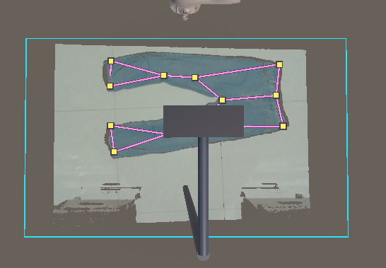

*Góc nhìn camera trong cảnh 3D Unity. Các điểm vàng biểu diễn mốc trên phôi.*

## Mục lục

- [Yêu cầu và cài đặt](#yêu-cầu-và-cài-đặt)
- [Chạy thử trong Unity](#chạy-thử-trong-unity)
- [Mô hình AI và kết quả huấn luyện](#mô-hình-ai-và-kết-quả-huấn-luyện)
- [Nhận diện AI và chụp Zivid](#nhận-diện-ai-và-chụp-zivid)
- [Tính năng Unity](#tính-năng-unity)
- [Vá lỗ và dựng mesh](#bù-vùng-khuất-và-dựng-mesh)
- [Vẽ mẫu và sinh quỹ đạo P1–P4](#vẽ-mẫu-và-sinh-quỹ-đạo-p1p4)
- [Động học và hiệu chuẩn](#động-học-và-hiệu-chuẩn)
- [Đánh giá, kiểm tra và xuất kết quả](#đánh-giá-kiểm-tra-và-xuất-kết-quả)
- [Xử lý sự cố](#xử-lý-sự-cố)
- [Cấu trúc dự án](#cấu-trúc-dự-án)

## Yêu cầu và cài đặt

Hướng dẫn dưới đây dùng Windows và PowerShell. Hộp thoại chọn tệp của Unity tích hợp File Explorer. Cài đúng phiên bản **Unity 6000.4.5f1** ghi trong [ProjectVersion.txt](dobot_cr10a/ProjectSettings/ProjectVersion.txt). Dự án dùng Universal Render Pipeline (URP).

| Chế độ chạy | Cần chuẩn bị |
| --- | --- |
| Mô phỏng bằng mẫu có sẵn | Unity Hub và Unity Editor |
| Nhận diện phôi từ PLY | Python, trọng số YOLO11 và PLY có màu |
| Chụp Zivid | Zivid SDK, gói Python Zivid và camera hoặc tệp `.zfc` |

Dữ liệu mô phỏng có sẵn trong dự án. Hai trọng số AI nằm trong `ai_src/step2_train_yolo/weights/`. Nếu dùng camera thật, kết nối Zivid qua Ethernet.

Clone kho lưu trữ hoặc giải nén toàn bộ mã nguồn. Giữ `ai_src` và `dobot_cr10a` cùng cấp để thành phần AI và Unity tìm được dữ liệu chung.

```powershell
git clone https://github.com/Dinameo/robot3t_phun.git
cd robot3t_phun
```

Mô phỏng bằng quỹ đạo mẫu chỉ cần Unity. Để dùng nhận diện, cài Python 3.11 rồi chạy các lệnh sau trong PowerShell tại thư mục gốc dự án. Nếu chụp Zivid, chọn phiên bản Python tương thích với bản SDK và thay `-3.11` tương ứng.

```powershell
py -3.11 -m venv .venv
.\.venv\Scripts\python.exe -m pip install --upgrade pip
.\.venv\Scripts\python.exe -m pip install -r requirements.txt
```

Kiểm tra môi trường đã nhập được các thư viện và tìm thấy cả hai trọng số.

```powershell
.\.venv\Scripts\python.exe -c "import cv2, numpy, scipy, sklearn, torch, ultralytics; print('AI dependencies OK')"
Get-Item .\ai_src\step2_train_yolo\weights\best_yolo11_seg.pt, .\ai_src\step2_train_yolo\weights\best_yolo11_pose.pt
```

Nếu PowerShell báo không tìm thấy `py`, cài Python hoặc dùng đường dẫn đến `python.exe` đúng phiên bản để tạo môi trường.

## Chạy thử trong Unity

1. Mở **Unity Hub**, chọn **Add project from disk** và trỏ tới thư mục `dobot_cr10a`. Chờ Unity nhập assets, tải packages và biên dịch C#.
2. Trong cửa sổ **Project**, mở scene chính trong `Assets/Scenes/`. Nhánh `main` dùng [SampleScene.unity](dobot_cr10a/Assets/Scenes/SampleScene.unity). Nếu bản đang mở đã đổi tên scene thành `phunson.unity`, dùng scene đó. Bấm **Play** và chuyển sang cửa sổ **Game**.
3. Vào **1. Phôi → Nạp phôi → Chọn file .PLY…**. Chọn [full_cloud_world.ply](dobot_cr10a/Assets/PointCloud/full_cloud_world.ply) trong `dobot_cr10a/Assets/PointCloud/`. Dùng **2. Views → Focus Phôi** nếu cần đưa phôi vào giữa khung nhìn.
4. Vào **5. Xuất → Nạp file CSV**, chọn [pants_outline_cr10a.csv](dobot_cr10a/output_drawing/pants_outline_cr10a.csv) trong `dobot_cr10a/output_drawing/`. Nút **Mẫu mặc định** trong tab Phôi cũng nạp đường bao mẫu này.
5. Mở **7. ĐG & An toàn → Kiểm tra an toàn → Quét lại quỹ đạo**. Kiểm tra các điểm báo lỗi trong **4. Chỉnh điểm**.
6. Mở **3. Quỹ đạo & MP → Mô phỏng**, chọn tốc độ `0.5x` và bấm **Chạy**. Theo dõi thanh tiến trình ở góc dưới bên phải. Dùng **Tạm dừng**, **Dừng** hoặc **Home** để kiểm tra lại tư thế.
7. Để chạy mẫu tự vẽ, nạp phôi có đường bao và mốc, rồi vào **Dạy phun & Quỹ đạo**, vẽ mẫu, chọn P1–P4 và bấm **Sinh quỹ đạo** tương ứng. Kiểm tra lại trước khi mô phỏng hoặc xuất tệp trong tab **5. Xuất**.

Hai scene [Robot_FK_IK](dobot_cr10a/Assets/Scenes/Robot_FK_IK.unity) và [CR10A_Manual_Kinematics](dobot_cr10a/Assets/Scenes/CR10A_Manual_Kinematics.unity) phục vụ thực hành động học. Để đóng gói ứng dụng, thoát Play Mode rồi vào **File → Build Profiles**, chọn Windows, kiểm tra scene chính được bật trong danh sách scene và chọn **Build And Run**. Lưu bản build vào thư mục riêng. Trong bản build có thể duyệt đến PLY và CSV trong thư mục mã nguồn. Nếu muốn dùng **Mẫu mặc định** trong bản build, đặt bản sao `pants_outline_cr10a.csv` trong thư mục `output_drawing` cạnh tệp thực thi.

## Mô hình AI và kết quả huấn luyện

Hệ thống sử dụng hai mô hình **Ultralytics YOLO11s** huấn luyện trên GPU Kaggle (`imgsz=640`, `batch=16`, AMP bật, augmentation xoay `±15°`, scale `0.25`, lật ngang `0.5`, mosaic `0.5`, tắt mosaic 10 epoch cuối).

### Bảng tổng hợp kết quả huấn luyện

Các giá trị mAP lấy trên tập validation của lần huấn luyện, theo báo cáo [Pose](ai_src/step2_train_yolo/reports/yolo11s_pose_jeans/results.csv) và [Seg](ai_src/step2_train_yolo/reports/yolo11s_seg_jeans/results.csv). Cột F1 lấy từ các đồ thị tương ứng.

| Chỉ tiêu | YOLO11s-Pose | YOLO11s-Seg |
| --- | --- | --- |
| Nhiệm vụ | Định vị 12 mốc | Phân đoạn thân quần |
| Trọng số | `best_yolo11_pose.pt` (19.8 MB) | `best_yolo11_seg.pt` (20.5 MB) |
| Số epoch | 120 | 100 |
| Thời gian huấn luyện | Khoảng 16.2 phút | Khoảng 15.7 phút |
| Box mAP@50 | 99.50% | 99.50% |
| Box mAP@50–95 cao nhất | 91.81% | 99.05% |
| Pose/Mask mAP@50 | 99.50% | 99.50% |
| Pose/Mask mAP@50–95 cao nhất | **94.56%** (epoch 114) | **98.78%** (epoch 80) |
| Đỉnh F1 và ngưỡng confidence | 1.00 tại 0.825 | 1.00 tại 0.910 |


### Mô hình YOLO11s-Pose (Định vị 12 điểm mốc giải phẫu)

Các chỉ số mốc theo thứ tự M0–M11 gồm `0: waist_left`, `1: waist_center`, `2: waist_right`, `3: crotch`, `4: thigh_left`, `5: thigh_right`, `6: knee_left`, `7: knee_right`, `8: cuff_left_outer`, `9: cuff_left_inner`, `10: cuff_right_inner`, `11: cuff_right_outer`.


*Biểu đồ hàm mất mát (Train/Val Box, Pose, Keypoint Objectness) và độ chính xác mAP qua 120 epochs của YOLO11s-Pose (`val/pose_loss` giảm từ 12.75 xuống 0.38).*

| Đường cong Pose F1-Confidence | Đường cong Pose Precision-Recall |
| :---: | :---: |
| 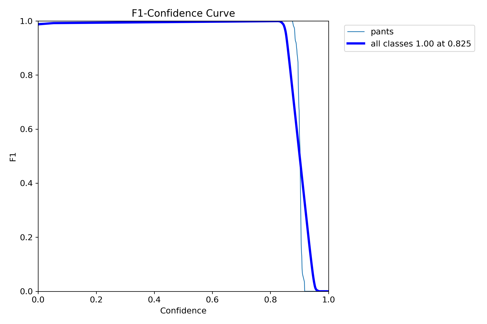 |  |

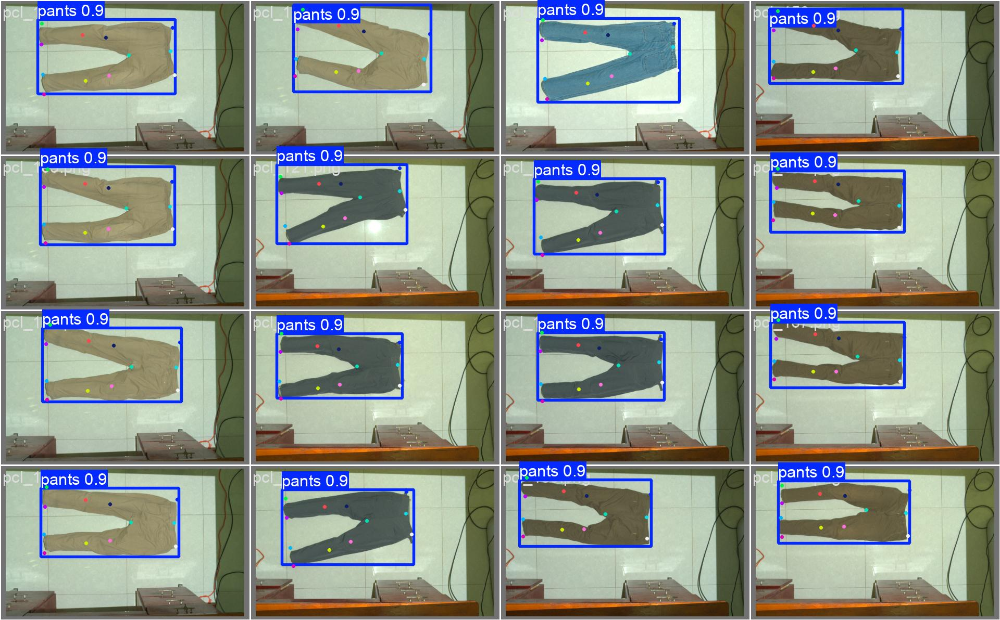

*Kết quả dự đoán khung bao và 12 mốc giải phẫu trên batch kiểm định (Validation) với nhiều màu vải và góc đặt quần khác nhau.*


### Mô hình YOLO11s-Seg (Phân đoạn biên thân quần & tách nền)

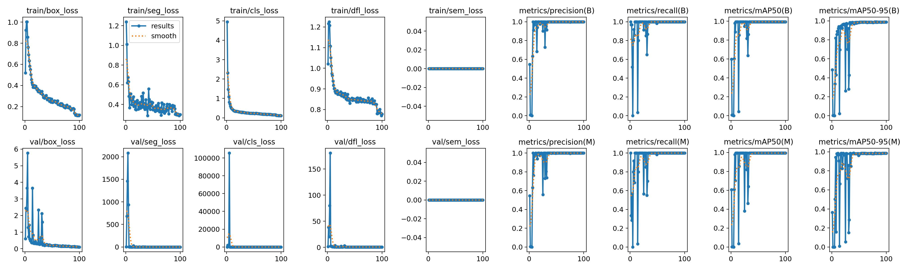

*Biểu đồ hàm mất mát và độ chính xác phân đoạn qua 100 epochs của YOLO11s-Seg (`val/seg_loss` giảm từ 3.19 xuống 0.30, Mask mAP@50-95 đạt 98.78%).*

| Đường cong Mask F1-Confidence | Đường cong Mask Precision-Recall |
| :---: | :---: |
| 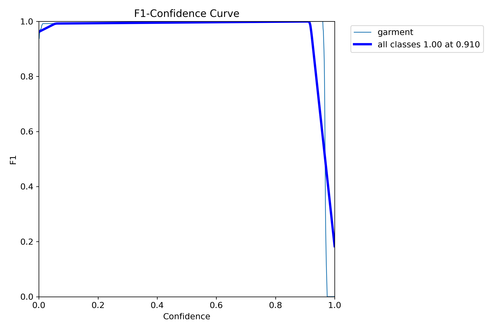 | 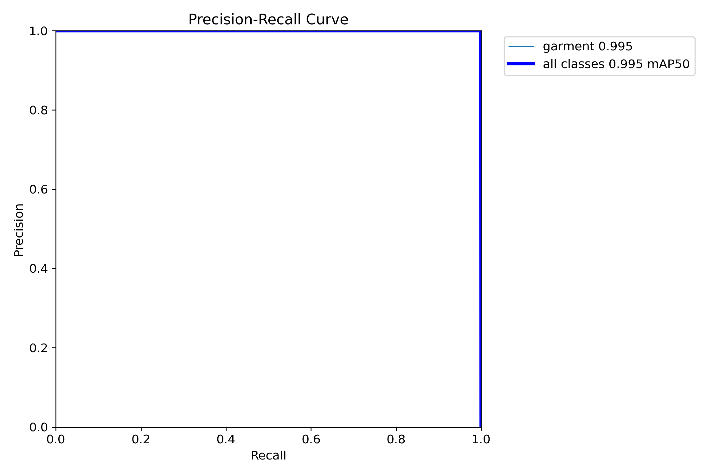 |

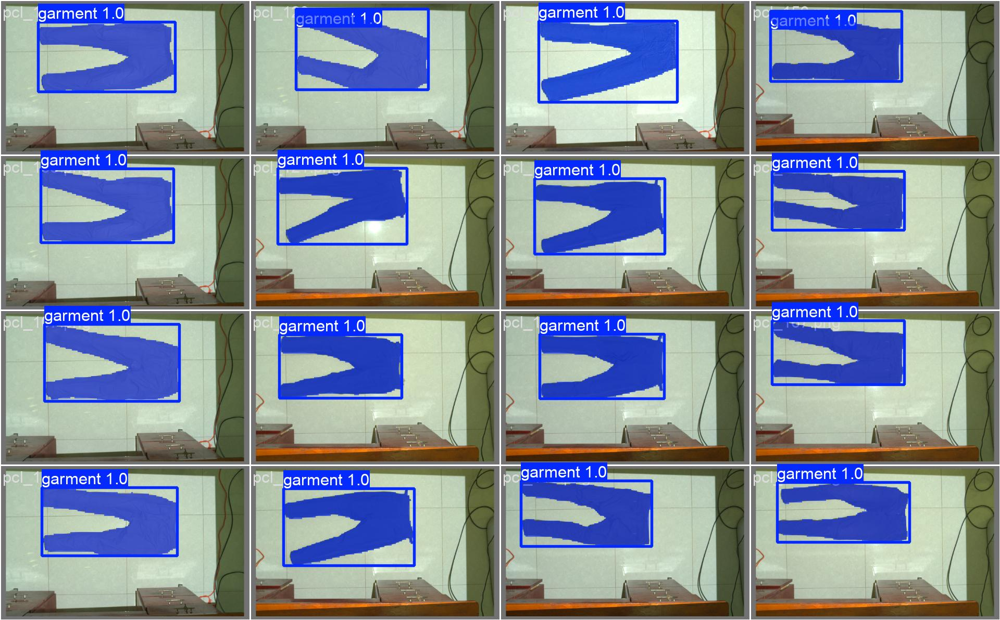

*Kết quả phân đoạn mặt nạ thân quần (confidence 1.0) trên batch Validation của YOLO11s-Seg.*


### Một số ảnh test kết hợp YOLO11s-Seg + YOLO11s-Pose

Các ảnh dưới đây là kết quả chạy `ai_src/step2_train_yolo/test_inference_step2.py` trên dữ liệu Zivid. Ảnh hiển thị đường bao phân đoạn, liên kết giữa 12 mốc và thời gian suy luận trên CPU.

| Mẫu `pcl_14` (Quần jean xanh) | Mẫu `pcl_105` (Quần kaki sáng) |
| :---: | :---: |
|  |  |
| **Mẫu `pcl_120` (Quần đặt nghiêng)** | **Mẫu `pcl_180` (Quần màu tối)** |
| 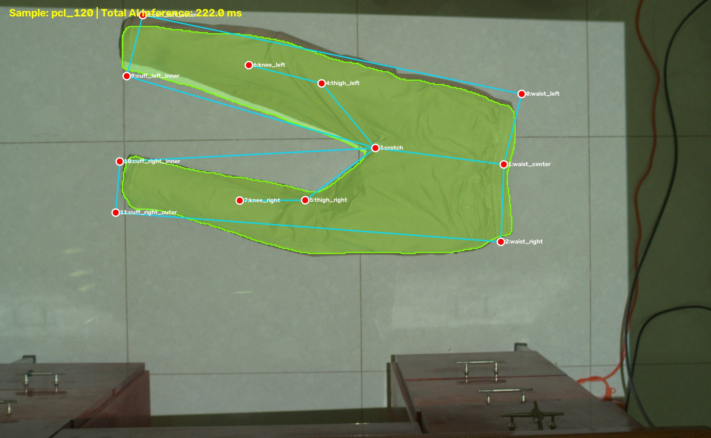 |  |

---

## Nhận diện AI và chụp Zivid

### Nhận diện từ PLY

Tại thư mục gốc của kho lưu trữ, khởi động tiến trình AI cục bộ và giữ cửa sổ lệnh mở trong lúc sử dụng.

```powershell
.\.venv\Scripts\python.exe ai_src\step3_3d_trajectory\run_server.py
```

1. Sau khi terminal báo `Models ready`, vào **1. Phôi**. Đặt địa chỉ `127.0.0.1`, cổng `5005`, chọn **UDP (5005)** và bấm **Ping**.
2. Nạp PLY có tọa độ XYZ và màu RGB. Với dữ liệu Zivid, ưu tiên bản xuất có tổ chức để giữ quan hệ giữa pixel ảnh và điểm 3D. Nếu có ảnh RGB đi kèm, giữ cùng tên gốc.
3. Bấm **Nhận diện [tên phôi]** và theo dõi thanh phần trăm ngay bên dưới. Kiểm tra 12 mốc, đường bao thân quần và size S/M/L trước khi dùng kết quả để tạo mẫu.
4. Nếu mốc lệch, vào **Đánh lại mốc AI**, đặt hoặc kéo các điểm M0–M11 rồi chọn **Áp dụng & Lưu mẫu sai**. Tab Phôi hiển thị số mẫu chờ và có nút **Train lại** cho YOLO11-Pose. Tùy chọn **Tự động nhận từ AI** nhận kết quả mới qua UDP cổng `5006`.

### Chụp trực tiếp từ Zivid

1. Cài Zivid SDK và phiên bản gói `zivid` tương ứng vào môi trường Python. Xác nhận camera chụp được trong Zivid Studio, sau đó ngắt kết nối trong Studio trước khi mở camera từ dự án.
2. Khởi động tiến trình AI như trên. Có thể truyền `--serial <serial_camera>` để chỉ định camera, `--settings <tep_yaml>` để dùng cấu hình chụp, `--file-camera <tep_zfc>` để thử bằng camera ảo, hoặc `--calibration <tep_json>` để dùng ma trận camera–robot đã lưu.
3. Trong **1. Phôi**, bảo đảm địa chỉ AI cục bộ đúng như hướng dẫn ở trên. Bấm **Chụp Zivid** để xem phôi vừa thu hoặc **Chụp + AI** để chụp rồi nhận diện. Giao diện hiển thị tiến độ chụp và nhận diện theo từng mục.
4. Kiểm tra ảnh và đám mây điểm trong **Views**. Dữ liệu thu được ghi vào `ai_src/dataset/_2D/` và `ai_src/dataset/_3D/`. Tệp 3D có thể gồm `.zdf`, `.ply`, `.npz` và metadata kích thước khung.

## Tính năng Unity

| Tab | Chức năng |
| --- | --- |
| **1. Phôi** | Nạp hoặc tải lại PLY, chụp Zivid, nhận diện và sửa 12 mốc, kiểm tra size. **Vá lỗ & Mesh** quét vùng khuyết, áp dụng thuật toán đã chọn, khôi phục dữ liệu gốc, cập nhật quỹ đạo và xuất mesh OBJ. |
| **2. Views** | Chọn góc 3/4, trên, trước, ngang, camera Zivid hoặc khung PiP. Lấy nét vào phôi hoặc robot, đổi giữa **Point Cloud** và **3D Mesh**, cập nhật mesh và bật/tắt các lớp hiển thị. |
| **3. Quỹ đạo & MP** | Vẽ tay, hình tròn, hình vuông/chữ nhật, đa giác, sửa nét và vùng vẽ. Chỉnh cỡ cọ, hoàn tác, xóa, đổi size mẫu, lưu/nạp JSON và cấu hình P1–P4. Mô phỏng có điều khiển tốc độ, trạng thái tia phun, hiển thị quỹ đạo và vệt màu. |
| **4. Chỉnh điểm** | Duyệt waypoint, chỉnh Roll/Pitch/Yaw, giải và xem trước các cấu hình IK trên robot. Áp dụng chỉnh sửa cho điểm đang chọn hoặc toàn bộ quỹ đạo. |
| **5. Xuất** | Xuất Dobot Python, CSV quỹ đạo 6-DOF và YAML ROS 2/MoveIt 2. Xem trước nội dung, mở thư mục xuất hoặc nạp CSV để kiểm tra. |
| **6. Cấu hình** | **Robot & Đầu phun** chỉnh các trục, ưu tiên nghiệm IK, thông số chuyển động, offset TCP và vệt phun. **Hiệu chuẩn Camera** chỉnh pose camera, kiểm tra sai số và quản lý ma trận biến đổi 4×4. |
| **7. ĐG & An toàn** | So sánh P1–P4 theo bộ chỉ tiêu, hiển thị heatmap Gauss, chọn dữ liệu tham chiếu, xuất CSV đánh giá và quét lỗi quỹ đạo trước khi mô phỏng hoặc xuất. |
| **8. Giới thiệu** (bản có tab này) | Thông tin ứng dụng, Robot 3T và các nhóm sản phẩm của Công ty Cổ phần Chế tạo máy 3C. |

Thanh trên cùng có các thao tác nhanh để chạy/tạm dừng, về Home, bật/tắt quỹ đạo, ẩn hoặc mở bảng bên phải và lưu setup. Kéo mép bảng để chỉnh chiều rộng. **Lưu setup** lưu cấu hình Workbench vào `dobot_cr10a/UserSettings/CR10A_WorkbenchSetup.json`. Cấu hình hiệu chuẩn có tệp `CR10A_CalibrationSetup.json` trong cùng thư mục.

### Góc nhìn và lớp hiển thị

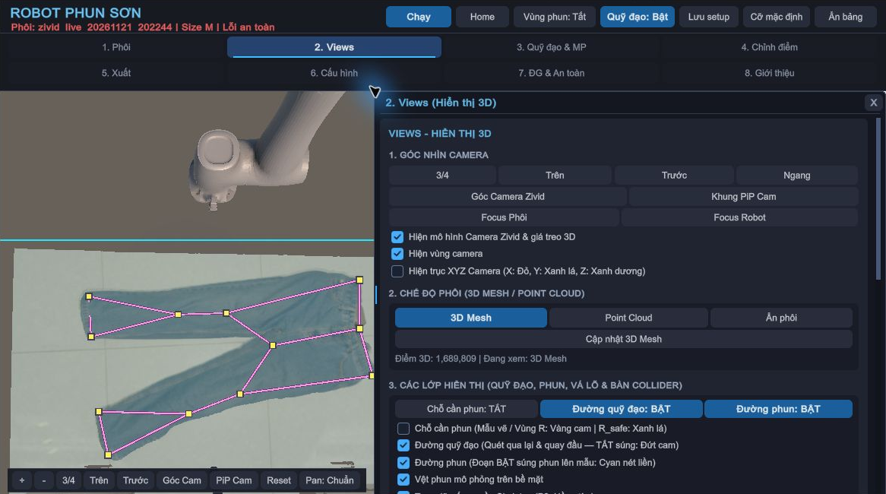

*Tab Views trong Unity với phôi đã nạp, điểm mốc, khung camera và chế độ 3D Mesh.*

Trong **Views**, các lớp **Chỗ cần phun**, **Đường quỹ đạo** và **Đường phun** có công tắc riêng để phân biệt vùng thiết kế, đoạn chuyển khi tắt súng và đoạn bật súng. Có thể hiện khung vùng camera, giá treo, trục XYZ camera, đường bao và mốc khi đối chiếu dữ liệu. Khi khung Game có tiêu điểm, phím `1`–`4` chuyển lần lượt sang góc 3/4, trên, ngang và trước. Phím `C` bật/tắt góc Zivid, `P` bật/tắt PiP.

### Bù vùng khuất và dựng mesh

Trong **1. Phôi → Vá lỗ & Mesh**, bấm **Quét & Đánh chéo lỗ** để xem vùng thiếu dữ liệu. Chọn phương pháp, chỉnh thông số rồi bấm **Vá & Áp dụng**. So sánh với mặt gốc trước khi dùng **Áp vào quỹ đạo** hoặc **Xuất Mesh (.OBJ)**.

| Phương pháp | Tác dụng |
| --- | --- |
| K-NN MLS | Ước lượng mặt phẳng cục bộ từ các điểm lân cận để điền vùng thiếu độ sâu. |
| Thin Plate Spline (TPS RBF) | Nội suy một bề mặt trơn từ các điểm tham chiếu quanh vùng khuyết. |
| Nội suy Laplace (PDE) | Nội suy độ cao bên trong vùng khuyết từ điều kiện biên. |
| Bù góc súng và nâng Z | Điều chỉnh hướng súng và khoảng lùi tại vùng khuất để tạo phương án tiếp cận. |
| Đối xứng hai ống quần | Dùng bề mặt của ống đối diện làm tham chiếu cho vùng bị thiếu. |

## Vẽ mẫu và sinh quỹ đạo P1–P4

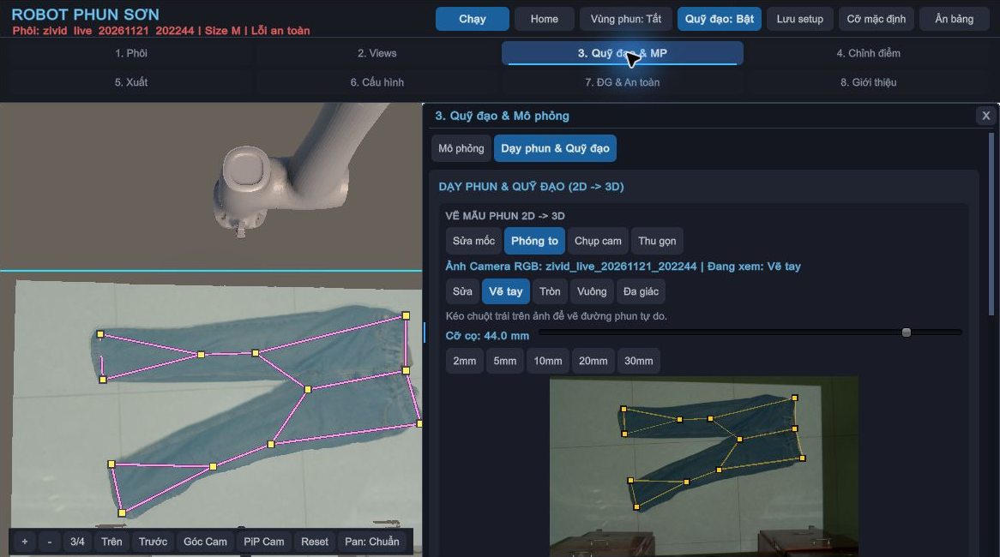

*Tab Dạy phun & Quỹ đạo hiển thị ảnh RGB của phôi, các mốc, công cụ vẽ và cỡ cọ.*

1. Trong **3. Quỹ đạo & MP → Dạy phun & Quỹ đạo**, mở bảng vẽ. Dùng **Vẽ tay** cho nét tự do hoặc **Tròn**, **Vuông** và **Đa giác** cho vùng kín. Tăng cỡ cọ để tạo nét rộng, bo tròn đầu nét. Dùng **Sửa** để điều chỉnh vùng đã vẽ.
2. Chọn P1–P4 và kiểm tra các tham số của phương pháp. Bật tùy chọn phủ vùng vẽ/nét cọ rộng nếu muốn chạy các lượt phun bên trong vùng, và xem tùy chọn cắt theo đường bao quần khi mẫu gần mép.
3. Bấm **Sinh quỹ đạo P1/P2/P3/P4** tương ứng. So sánh nét hoặc vùng trên bảng vẽ với đường 3D trên phôi. Kiểm tra các đoạn chuyển giữa lượt phun và các vùng bị cắt theo đường bao.
4. Dùng **Lưu mẫu** khi đã có hình vẽ, chọn phương pháp và điền cấu hình cần thiết. **Nạp mẫu** thay mẫu hiện tại, khôi phục phương pháp và thông số đã lưu, rồi hiển thị kết quả trên phôi đang dùng khi đủ dữ liệu.
5. Trong phần **Mô phỏng**, chọn **Solid (Đặc)** hoặc **Tia mờ tròn**, chỉnh bề rộng, độ đậm và màu phun. Có thể dùng màu có sẵn hoặc nhập RGB tùy chọn.

| Phương pháp | Cách tạo quỹ đạo |
| --- | --- |
| **P1 — Zigzag** | Quét các lượt song song qua vùng mẫu, đổi chiều giữa các lượt. Hướng quét có thể dựa theo trục chính của vùng, hình chữ nhật bao hoặc góc tùy chỉnh. |
| **P2 — Trục giữa** | Ước lượng trục giữa của vùng rồi tạo các lượt phun theo cấu trúc đó. Với P1 và P2 ở chế độ **2D phẳng**, cao độ tham chiếu lấy từ điểm cao nhất trên bề mặt phôi. Chế độ **2.5D** dùng độ cao cục bộ. |
| **P3 — 12 mốc** | Dùng tọa độ barycentric trong lưới tam giác của 12 mốc để ánh xạ mẫu giữa các phôi, sau đó đặt quỹ đạo theo chế độ bám bề mặt đã chọn. Vị trí và chất lượng mốc ảnh hưởng trực tiếp đến kết quả. |
| **P4 — Đăng ký đám mây điểm** | Khi đã chốt mẫu 3D, khởi tạo theo mốc hoặc PCA, tinh chỉnh bằng ICP, rồi áp biến dạng CPD hoặc TPS lên quỹ đạo mẫu. Kiểm tra sai số dư, bám mặt phôi đích và tính hướng súng. |

Để chuyển mẫu bằng **P4**, tạo quỹ đạo trên phôi chuẩn rồi mở cấu hình P4 và bấm **Lưu phôi & quỹ đạo làm mẫu chuẩn 3D**. Sau đó nạp phôi đích và sinh lại P4. Nếu size hoặc độ nhăn thay đổi nhiều, kiểm tra cả hình dạng mẫu lẫn khoảng cách giữa các lượt phun, vì quỹ đạo đã lưu có thể bị kéo giãn hoặc nén theo phép đăng ký.

## Động học và hiệu chuẩn

### Động học thuận FK

[DobotCR10AKinematics.cs](dobot_cr10a/Assets/src/DobotCR10AKinematics.cs) dùng quy ước Denavit–Hartenberg (DH) chuẩn. Mỗi khâu có phép biến đổi $A_i = R_z(\theta_i)\,T_z(d_i)\,T_x(a_i)\,R_x(\alpha_i)$. Các góc trong bảng tính theo độ và các kích thước theo mm.

| Khâu | Góc θ (°) | Lệch trục d (mm) | Chiều dài a (mm) | Góc xoắn α (°) |
| ---: | :--- | ---: | ---: | ---: |
| 1 | `q1` | 176.5 | 0 | +90 |
| 2 | `q2 + 90` | 193.0 | 607.0 | 0 |
| 3 | `q3` | −127.0 | 568.0 | 0 |
| 4 | `q4 - 90` | 125.0 | 0 | −90 |
| 5 | `q5` | 125.0 | 0 | +90 |
| 6 | `q6` | 111.0 | 0 | 0 |

**Kết quả từ đế đến mặt bích.** Với bộ góc kiểm thử $q = (20,\,-110,\,100,\,-110,\,100,\,25)^\circ$, tích $T_{06} = A_1A_2A_3A_4A_5A_6$ cho ma trận sau trong hệ DH của robot. Ba phần tử trên cột cuối là tọa độ theo mm.

```text
T06 =
[   0.112603    0.845419   -0.522099  737.775923 ]
[   0.990804   -0.135201   -0.005236   85.782492 ]
[  -0.075015   -0.516709   -0.852869  371.096170 ]
[          0           0           0           1 ]
```

**Kết quả từ đế đến đầu TCP.** Mô hình đầu phun dùng offset tịnh tiến $(x_6,y_6,z_6) = (0,0,100)$ mm theo hệ mặt bích. Vì offset không có phần xoay, hướng của TCP trùng hướng mặt bích.

```text
T6,TCP =
[          1           0           0           0 ]
[          0           1           0           0 ]
[          0           0           1         100 ]
[          0           0           0           1 ]

T0,TCP = T06 × T6,TCP =
[   0.112603    0.845419   -0.522099  685.565977 ]
[   0.990804   -0.135201   -0.005236   85.258879 ]
[  -0.075015   -0.516709   -0.852869  285.809316 ]
[          0           0           0           1 ]
```

TCP trong hệ DH có XYZ **(685.566, 85.259, 285.809) mm** và Roll/Pitch/Yaw **(−148.791°, 4.302°, 83.516°)** theo thứ tự quay Z–Y–X. Khi chuyển sang hệ robot trong Unity, mã đổi dấu X và đổi đơn vị từ mm sang mét. Với $S_x = \operatorname{diag}(-1,1,1)$, $p_U = 0.001 S_x p_{DH}$ và $R_U = S_x R_{DH} S_x$. Có thể quan sát chuyển động theo từng khớp trong **6. Cấu hình → Robot & Đầu phun** hoặc các scene kiểm tra FK/IK.

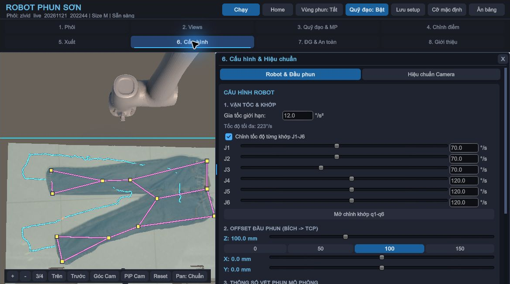

*Tab Cấu hình robot hiển thị giới hạn chuyển động từng khớp và offset mặt bích đến TCP.*

### Động học nghịch IK

#### Công thức giải tích cho sáu góc khớp

Các công thức dưới đây theo [bộ giải IK trong Unity](dobot_cr10a/Assets/src/DobotCR10AKinematics.cs#L457). Tính góc bằng radian rồi đổi sang độ để lập bảng nghiệm. Ký hiệu `tᵢⱼ` chỉ phần tử hàng i, cột j của `T16`, đếm từ 1.

**1. Từ TCP về mặt bích và cổ tay.** Cho pose đích trong hệ DH gồm vị trí `pTCP` và ma trận quay `R = [x₆, y₆, z₆]`. Offset đầu phun `(ox, oy, oz)` được đo theo ba trục của mặt bích. Dùng `d6 = 111 mm` từ bảng DH.

```text
p06 = pTCP − ox·x₆ − oy·y₆ − oz·z₆
p05 = p06 − d6·z₆ = (X5, Y5, Z5)
T06 = [R | p06; 0 0 0 | 1]
```

**2. Giải khớp vai q1.** Từ `Y5·cos(q1) − X5·sin(q1) = H`, đặt `H = −(d2 + d3 + d4) = −191 mm`. Dấu `s1 = +1` ứng với vai trái, `−1` ứng với vai phải.

```text
Δ1 = X5² + Y5² − H²
q1 = wrap(atan2(H, s1·√Δ1) − atan2(Y5, −X5))
```

Nếu `Δ1 < 0` vượt dung sai số học, pose đích nằm trong vùng không giải được của khớp vai.

**3. Giải cổ tay q5, q6 và tổng q234.** Dùng `T16 = A1⁻¹·T06`. Dấu `s5 = +1` ứng với cổ tay ngửa, `−1` ứng với cổ tay úp.

```text
c5 = clamp(t33, −1, 1)
u5 = s5·√(1 − c5²)
q5 = atan2(u5, c5)

q6   = atan2( t32/u5, −t31/u5)
q234 = atan2( t23/u5,  t13/u5)
```

Khi `|u5| ≤ 10⁻⁴`, giữ q6 ở giá trị hiện tại hoặc dùng 0 nếu chưa có tư thế tham chiếu. Khi đó đặt `φ = atan2(t21, t11)`, rồi dùng `q234 = φ − q6` nếu `c5 ≥ 0`, hoặc `q234 = φ + q6` nếu `c5 < 0`.

**4. Giải cơ cấu tay phẳng q2, q3, q4.** Từ `p15 = A1⁻¹·[p05; 1]`, lấy hai tọa độ đầu và lùi theo `d5 = 125 mm`. Hai chiều dài tay là `L2 = 607 mm` và `L3 = 568 mm`. Dấu `s3 = +1` ứng với khuỷu trên, `−1` ứng với khuỷu dưới.

```text
x14 = x15 + d5·sin(q234)
y14 = y15 − d5·cos(q234)

c3 = (x14² + y14² − L2² − L3²)/(2·L2·L3)
u3 = s3·√(1 − c3²)
q3 = atan2(u3, c3)

K1 = L2 + L3·c3
K2 = L3·u3
q2 = atan2(−x14, y14) − atan2(K2, K1)
q4 = q234 − q2 − q3
```

Nếu `c3` nằm ngoài `[−1, 1]` quá dung sai, loại nhánh đó vì vượt tầm với. Bộ giải chuẩn hóa góc, kiểm tra giới hạn khớp và tính lại vị trí, hướng TCP bằng FK. Hàm `wrap` đưa góc về quanh khoảng ±π. Riêng J6 được chọn góc tương đương gần tư thế hiện tại khi nằm trong giới hạn cho phép. Khi có tư thế hiện tại, bộ giải xếp nghiệm theo chi phí `Σ wᵢ·wrap(qᵢ − qᵢ_hiện_tại)²`, với `w = (1.2, 1.2, 1.0, 0.8, 0.8, 0.5)`.

#### Kết quả số của ví dụ FK

Với pose ở phần FK, tâm cổ tay tính theo công thức trên là `p05 = (795.729, 86.364, 465.765) mm` trong hệ DH.

Với pose TCP lấy từ ví dụ FK ở trên, bộ giải `SolveTcpPose` tìm được **8 bộ nghiệm**. Kết quả dùng offset TCP 100 mm dọc trục Z mặt bích, không bật bù góc thích ứng và dùng bộ góc của ví dụ FK làm tư thế tham chiếu để sắp thứ tự nghiệm.

| Nghiệm | Vai | Cổ tay | Khuỷu | J1 (°) | J2 (°) | J3 (°) | J4 (°) | J5 (°) | J6 (°) |
| ---: | --- | --- | --- | ---: | ---: | ---: | ---: | ---: | ---: |
| 1 | Phải | Ngửa | Trên | 20.0000 | −110.0000 | 100.0000 | −110.0000 | 100.0000 | 25.0000 |
| 2 | Phải | Ngửa | Dưới | 20.0000 | −14.5304 | −100.0000 | −5.4696 | 100.0000 | 25.0000 |
| 3 | Phải | Úp | Trên | 20.0000 | −113.0507 | 77.9023 | 95.1484 | −100.0000 | −155.0000 |
| 4 | Trái | Ngửa | Trên | 172.3886 | 38.2029 | 78.1924 | −175.1811 | 94.2635 | 181.2659 |
| 5 | Phải | Úp | Dưới | 20.0000 | −38.2223 | −77.9023 | 176.1246 | −100.0000 | −155.0000 |
| 6 | Trái | Úp | Trên | 172.3886 | 14.5579 | 99.7119 | 6.9445 | −94.2635 | 1.2659 |
| 7 | Trái | Ngửa | Dưới | 172.3886 | 113.3055 | −78.1924 | −93.8988 | 94.2635 | 181.2659 |
| 8 | Trái | Úp | Dưới | 172.3886 | 109.7624 | −99.7119 | 111.1638 | −94.2635 | 1.2659 |

Đối chiếu bằng FK trước khi làm tròn các góc cho sai số vị trí lớn nhất khoảng $1.35\times10^{-6}$ mm và chuẩn Frobenius của chênh lệch ma trận quay khoảng $2.72\times10^{-8}$. Đây là sai số số học của ví dụ. Số nhánh thực tế thay đổi theo pose và giới hạn khớp. Trong **4. Chỉnh điểm**, có thể xem trước từng nghiệm và áp dụng cho waypoint đang chọn.

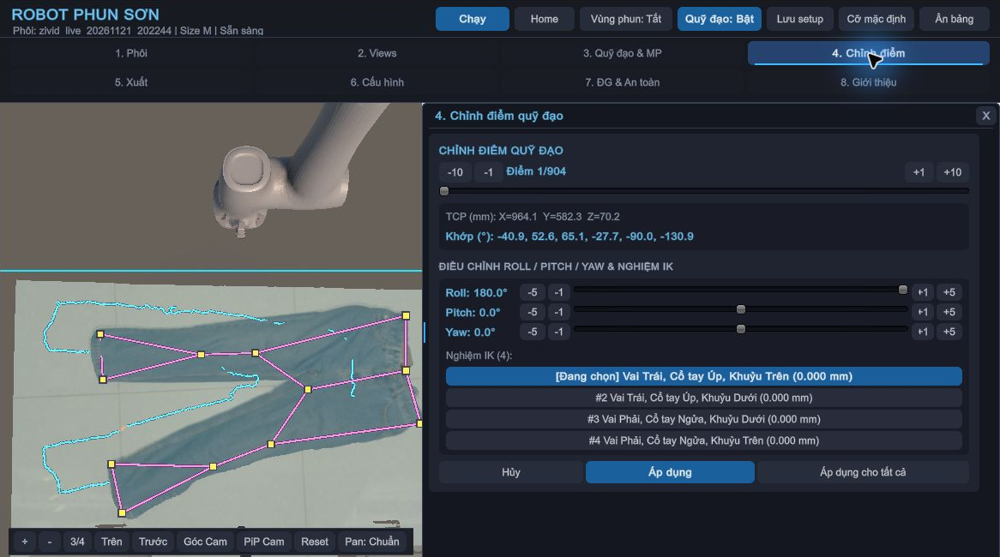

*Tab Chỉnh điểm trong Unity hiển thị bốn nghiệm cho waypoint của quỹ đạo mẫu. Bảng tám nghiệm phía trên dùng pose kiểm thử riêng.*

Với chế độ bám pháp tuyến, TCP đặt tại điểm trên bề mặt cộng khoảng lùi theo pháp tuyến, $P_{\mathrm{TCP}} = P_{\mathrm{mặt}} + d\,n$. Trục phun hướng về phôi và góc nghiêng chịu giới hạn trong cấu hình. Chế độ phẳng dùng cao độ chung và hướng súng thẳng đứng.

### Hiệu chuẩn camera–robot

Trong **6. Cấu hình → Hiệu chuẩn Camera**, có thể chỉnh Tx/Ty/Tz và Roll/Pitch/Yaw, xem trường nhìn camera, đo sai số tại điểm đối chiếu hoặc bù tịnh tiến. Để giải ma trận biến đổi cứng camera → robot, nhập ít nhất ba cặp điểm tương ứng không thẳng hàng, bấm **Giải 4x4 (SVD)**, xem sai số và lưu JSON. Kiểm tra lại hệ tọa độ và offset TCP sau khi thay vị trí camera hoặc dụng cụ.

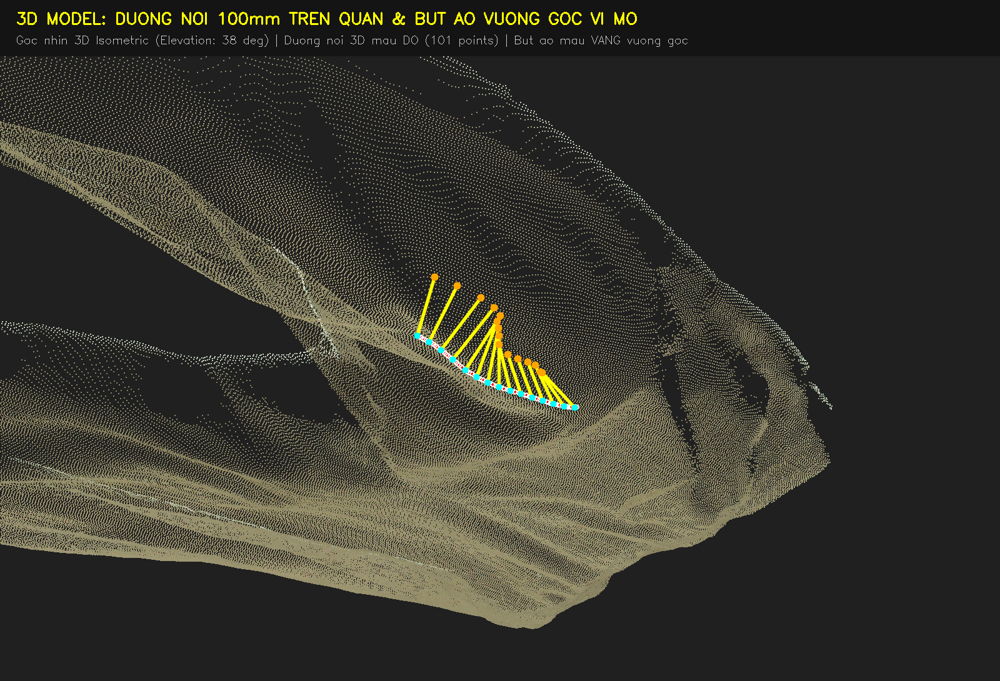

*Hình kết xuất từ dữ liệu dự án, minh họa vị trí và hướng công cụ dọc quỹ đạo 3D.*

## Đánh giá, kiểm tra và xuất kết quả

1. Trong **7. ĐG & An toàn → Đánh giá & Gauss**, đặt khoảng cách súng, bề rộng vệt, tỷ lệ chồng lấn, sigma Gauss, biên và giới hạn góc nghiêng.
2. Dùng **Chốt vẽ tay làm GT** hoặc **Nạp GT (.csv)** để đưa quỹ đạo tham chiếu vào phép so sánh hình học. Bấm **Chạy so sánh P1/P2/P3/P4**, rồi mở bảng đầy đủ. Bảng gồm 12 chỉ tiêu về hình học, phun, khả thi và vận hành, cùng ngưỡng loại, điểm có trọng số và độ nhạy khi đổi trọng số ±10 điểm phần trăm. Heatmap biểu diễn mật độ dự đoán theo mô hình Gauss.
3. Mở **Kiểm tra an toàn → Quét lại quỹ đạo** để xem trạng thái IK, giới hạn khớp, khoảng hở bàn và góc nghiêng. Quay lại **Chỉnh điểm** nếu cần, sau đó quét lại trước khi xuất.

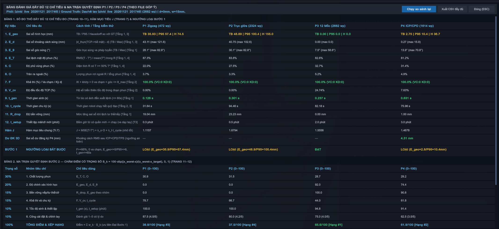

*Ảnh màn hình một lượt so sánh trong dự án. Kết quả phụ thuộc phôi, mẫu, tham số và dữ liệu tham chiếu.*

| Tệp xuất | Nội dung |
| --- | --- |
| CSV quỹ đạo 6-DOF | Tọa độ TCP, góc hướng, sáu góc khớp và thông tin đoạn phun. Có thể nạp lại qua tab **Xuất**. |
| Dobot Python | Mã chương trình quỹ đạo, gồm lệnh chuyển động và trạng thái bật/tắt phun. |
| ROS 2 / MoveIt 2 YAML | Dữ liệu quỹ đạo khớp để tích hợp với quy trình ROS 2. |
| CSV đánh giá | Kết quả so sánh các phương pháp, xuất từ tab **ĐG & An toàn**. |
| OBJ | Mesh của phôi, xuất từ **Vá lỗ & Mesh**. |

Các tệp xuất mô phỏng thường nằm trong `dobot_cr10a/output_drawing/`. Trước khi dùng với thiết bị thật, người phụ trách cần xác nhận lại hệ tọa độ, TCP, trạng thái I/O và các giới hạn tại trạm.

## Xử lý sự cố

| Hiện tượng | Kiểm tra |
| --- | --- |
| Unity không vào Play Mode | Mở Console, xử lý lỗi biên dịch và kiểm tra phiên bản Editor theo `ProjectVersion.txt`. |
| Phôi nằm ngoài khung nhìn hoặc sai tỷ lệ | Dùng **Focus Phôi**. Kiểm tra hệ trục, đơn vị của tệp PLY, pose camera và hiệu chuẩn. |
| Ping được nhưng nhận diện chưa chạy | Kiểm tra terminal đã báo `Models ready`, đúng hai trọng số và PLY có cả XYZ lẫn RGB. |
| Nhận diện thiếu mốc hoặc sai đường bao | Xem ảnh camera, chỉnh mốc bằng **Đánh lại mốc AI** hoặc chụp lại khi ảnh bị che/mất độ sâu. |
| Bấm sinh quỹ đạo mà không có điểm | Kiểm tra đã vẽ hoặc nạp mẫu, đã chọn phương pháp và phôi có đường bao. Với P3 kiểm tra đủ mốc. Với P4 kiểm tra mẫu chuẩn, phôi đích và sai số dư. |
| Quỹ đạo sinh được nhưng mô phỏng hoặc xuất bị báo lỗi | Xem từng waypoint trong **Chỉnh điểm**, chọn nghiệm IK hợp lệ, kiểm tra TCP và quét lại an toàn. |
| Zivid không chụp | Kiểm tra kết nối Ethernet, quyền truy cập camera, phiên bản SDK và gói Python. Ngắt kết nối camera trong Zivid Studio trước khi thử lại. |

## Cấu trúc dự án

| Đường dẫn | Vai trò |
| --- | --- |
| [dobot_cr10a/Assets/Scenes](dobot_cr10a/Assets/Scenes) | Scene phun sơn và scene kiểm tra động học. |
| [dobot_cr10a/Assets/src](dobot_cr10a/Assets/src) | Điều khiển Unity, FK/IK, đọc PLY, vẽ mẫu, sinh và đánh giá quỹ đạo, hiệu chuẩn và camera. |
| [dobot_cr10a/Assets/PointCloud](dobot_cr10a/Assets/PointCloud) | Phôi và tài nguyên đám mây điểm mẫu. |
| [dobot_cr10a/output_drawing](dobot_cr10a/output_drawing) | Mẫu phun JSON, quỹ đạo CSV và kết quả xuất. |
| [ai_src/step1_auto_label](ai_src/step1_auto_label) | Công cụ gán nhãn và chỉnh mốc ảnh/3D. |
| [ai_src/step2_train_yolo](ai_src/step2_train_yolo) | Trọng số, huấn luyện và báo cáo YOLO11s-Seg/Pose, kiểm thử nhận diện và học từ mẫu đã sửa. |
| [ai_src/step3_3d_trajectory](ai_src/step3_3d_trajectory) | Chụp Zivid, đọc/ghi RGB–XYZ, nhận diện, hiệu chuẩn và kết xuất quỹ đạo 3D. |
| [docs/images](docs/images) | Ảnh chụp giao diện Unity dùng trong tài liệu này. |
